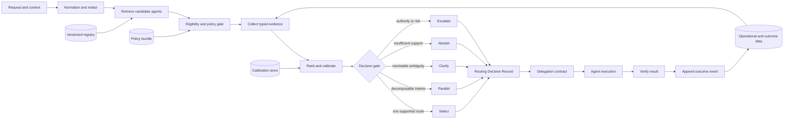

# Evidence-Grounded Agent Routing

## A Decision-Provenance Framework for Auditable Routing and Delegation in Agentic Systems

**Vijay Prakash Tiwari** · [GitHub profile](https://github.com/vijayptiwari)

Version 0.1.0 · Architecture, reference implementation, and evaluation proposal · 6 September 2026

Research cutoff: 5 September 2026

> This paper proposes an architecture and an evaluation protocol. It reports synthetic implementation smoke tests, not independent empirical validation, and makes no regulatory-compliance claim.

Companion release 0.1.0 includes a dependency-free Python reference implementation, optional LangGraph and Langfuse adapters, versioned schemas, replay and integrity checks, a synthetic development benchmark, baseline and ablation harnesses, and a controlled RCA-study protocol. Synthetic smoke results are software verification, not empirical support for the paper's production hypotheses.

## Abstract

Agentic systems increasingly route requests among specialized agents, tools, and models. In many implementations, however, the router emits only a label or a numeric score. The selected path is visible; the rejected alternatives, capability claims, constraints, uncertainty, and exact configuration that produced the choice are not. This creates an operational gap: a routing decision can be explainable in prose yet remain irreproducible, uncalibrated, or unsupported by evidence.

This paper proposes **evidence-grounded agent routing**, a lifecycle that treats routing as a versioned decision rather than a classification label. For each candidate, it records source-linked evidence, capability and policy eligibility, raw fit, calibrated success probability when available, expected utility, and machine-readable reason codes. It gives uncertainty first-class outcomes—`clarify`, `abstain`, and `escalate`—alongside single-agent and parallel selection. The route then becomes a bounded delegation contract, and execution produces a separate outcome record for evaluation and recalibration.

The proposal synthesizes established ideas from Contract Net task allocation, LLM routing, selective prediction, provenance, explainable AI, and agent observability. Its contribution is not a universal scoring formula or a claim of new task-allocation theory. It is an implementable decision-provenance model, a JSON Schema, a LangGraph/LangChain reference mapping, and a falsifiable evaluation protocol. Until experiments establish benefits, *evidence-grounded* is deliberately preferred to *evidence-based*.

## Executive thesis

A production router should be able to answer six questions after every decision:

1. What request and context did the router observe?
2. Which versioned agents and capabilities were considered?
3. What source-linked evidence supported or weakened each candidate?
4. Which policy, availability, or authority constraints changed eligibility?
5. How uncertain was the decision, and why did the system select, clarify, abstain, fan out, or escalate?
6. What happened after delegation, and can that outcome be connected to the original decision without rewriting it?

If the system retains only `selected_agent = billing`, it cannot answer these questions. If it retains only a generated rationale, it may preserve a plausible story rather than the causes of the route. The proposed Routing Decision Record (RDR) therefore captures structured, externally inspectable inputs and computations. Human-readable explanations are rendered from that record.

The architecture rests on one separation:

> Evidence is not eligibility. A score is not a probability. Probability is not utility. Policy is not intent. Explanation is not provenance.

## 1. The problem with label-only and score-only routing

A common router asks a model to map a request to an agent name:

```text
request → prompt-based classifier → selected agent
```

This can be adequate for a small, low-risk system. It becomes difficult to operate when prompts change, the registry grows, tools become unavailable, policies vary by tenant, or failures require review. The result usually omits candidates that lost, the versions of the agent descriptions that were read, whether a requested agent was authorized, and whether a numeric confidence meant anything statistically.

The initial design behind this paper improved the pattern by scoring four “intent pillars”: direct, alias, semantic, and domain evidence, followed by a guardrail check. That intuition is useful, but a fixed weighted sum creates five problems.

### 1.1 It combines unlike quantities

An explicit instruction such as “use the Billing Agent” is a control signal, subject to authority and policy. A lexical match and a semantic match are correlated observations about relevance. Domain ownership is usually an eligibility condition. Guardrails are policy decisions. Adding all of them hides those differences.

### 1.2 It may count the same evidence twice

The word “invoice” can drive both a lexical score and a semantic model score. Without a dependency model or an empirical calibrator, a weighted sum gives duplicated evidence more influence merely because two feature extractors noticed it.

### 1.3 Its scale has no operational meaning

A value of `8.4/10` is not necessarily an 84% chance of success. Modern neural scores and generative-model probabilities can be miscalibrated; calibration must be measured against a defined outcome on held-out data ([Guo et al., 2017](https://proceedings.mlr.press/v70/guo17a.html); [Jiang et al., 2021](https://aclanthology.org/2021.tacl-1.57/)). Verbalized LLM confidence is also sensitive to prompting ([Yang et al., 2024](https://arxiv.org/abs/2412.14737)).

### 1.4 It forces a winner

Real requests may be ambiguous, multi-intent, out of domain, blocked by policy, or unsupported because a tool is down. “Highest eligible score wins” has no principled representation for these different states.

### 1.5 It obscures reproducibility

A score without a source, method, time, registry version, prompt version, and policy version cannot establish which decision process actually ran.

There is also a simple arithmetic warning. Under the draft formula—semantic 40%, alias 30%, direct 20%, domain 10%—the worked totals are:

```text
(0.40 × 9)  + (0.30 × 8) + (0.20 × 0) + (0.10 × 10) = 7.0
(0.40 × 10) + (0.30 × 4) + (0.20 × 0) + (0.10 × 10) = 6.2
(0.40 × 2)  + (0.30 × 1) + (0.20 × 0) + (0.10 × 5)  = 1.6
```

The draft reports `8.4`, `8.2`, and `2.3`. Correcting the calculation is necessary, but it does not repair the conceptual problem. No research found in this review establishes universal weights for these features.

## 2. Scope and vocabulary

The words *routing*, *delegation*, and *handoff* are often used interchangeably. This paper keeps them distinct.

- **Routing** chooses one or more next handlers for a request or subtask.
- **Delegation** assigns a bounded task with authority, inputs, obligations, acceptance criteria, and return conditions.
- **Handoff** transfers active conversational responsibility and relevant state.
- **Model routing** chooses an inference model for a request.
- **Tool routing** chooses an executable capability.
- **Multi-agent-system routing** may also choose a collaboration topology, role set, or execution plan.

Current LangChain documentation makes a similar operational distinction between router and supervisor patterns, and supports both single dispatch and parallel fan-out ([router documentation](https://docs.langchain.com/oss/python/langchain/multi-agent/router)). LangChain handoffs are state-driven transitions rather than merely labels ([handoffs documentation](https://docs.langchain.com/oss/python/langchain/multi-agent/handoffs)).

The proposed record is designed for application-level routing among registered agents. It can reference nested model and tool routes, but it does not pretend that a good model choice proves a good delegation or that a correct agent choice guarantees successful execution.

## 3. Related work and the novelty boundary

### 3.1 Task allocation is not new

The 1980 Contract Net Protocol already separated task announcements, eligibility specifications, bid requirements, deadlines, awards, refusals, and result reports ([Smith, 1980](https://doi.org/10.1109/TC.1980.1675516)). An agent-routing paper should not claim to invent evidence-aware task allocation. The important lesson is the lifecycle: selection is only one step between discovery and accountable execution.

### 3.2 Learned routing optimizes under empirical constraints

Model routers such as RouteLLM learn when to use stronger or weaker models and can reduce cost at a target quality in evaluated settings, but their usefulness is sensitive to data and deployment distribution ([RouteLLM, ICLR 2025](https://proceedings.iclr.cc/paper_files/paper/2025/hash/5503a7c69d48a2f86fc00b3dc09de686-Abstract-Conference.html)). RouterBench provides a common benchmark for cost-quality routing ([RouterBench](https://arxiv.org/abs/2403.12031)). More recent evidence is sobering: LLMRouterBench reports that many methods are close to simple baselines, that some fail to beat them, and that candidate recall constrains the attainable result ([LLMRouterBench, Findings of ACL 2026](https://aclanthology.org/2026.findings-acl.1881/)).

Multi-agent work extends the choice beyond a model. MasRouter jointly chooses collaboration modes, roles, and models ([ACL 2025](https://aclanthology.org/2025.acl-long.757/)); AgentRouter uses a knowledge graph and empirical performance signals for question-answering routes ([ACL 2026](https://aclanthology.org/2026.acl-long.33/)). These systems motivate richer features, but reported benchmark performance does not by itself create human-auditable decision evidence.

### 3.3 Capability retrieval is a separate bottleneck

Evaluating every agent is unnecessary for a small registry and expensive for a large one. ToolLLM demonstrated retrieval across a large API collection ([ICLR 2024](https://proceedings.iclr.cc/paper_files/paper/2024/hash/28e50ee5b72e90b50e7196fde8ea260e-Abstract-Conference.html)); ToolScope studies ambiguity and redundancy in large tool spaces ([ACL 2026](https://aclanthology.org/2026.acl-long.1573/)). Agents are not tools, but the engineering consequence transfers: measure candidate recall separately from final ranking.

### 3.4 Abstention is a designed outcome

Selective prediction treats refusal as a risk-coverage decision rather than an error path ([Geifman and El-Yaniv, 2017](https://papers.nips.cc/paper_files/paper/2017/hash/4a8423d5e91fda00bb7e46540e2b0cf1-Abstract.html); [SelectiveNet, 2019](https://proceedings.mlr.press/v97/geifman19a.html)). Under domain shift, a model may be confidently wrong; a separate calibrator improved selective question answering in the setting studied by Kamath, Jia, and Liang ([ACL 2020](https://aclanthology.org/2020.acl-main.503/)). Early work on conformal LLM routing offers a way to control a defined violation rate under statistical assumptions, but current evidence is limited in model pairs and benchmarks ([Uddin and Bauer, ACL SRW 2026](https://aclanthology.org/2026.acl-srw.70/)).

### 3.5 Provenance is stronger than a rationale

W3C PROV models entities, activities, agents, derivation, and delegation ([PROV overview](https://www.w3.org/TR/prov-overview/)). Decision provenance focuses on dataflow through decision systems so that accountability does not end at a single component ([Singh, Cobbe, and Norval, 2019](https://doi.org/10.1109/ACCESS.2018.2887201)). NIST's explainability principles distinguish the existence of an explanation from its accuracy and the system's knowledge limits ([NISTIR 8312](https://doi.org/10.6028/NIST.IR.8312)).

This distinction matters because generated reasoning can be unfaithful to the actual cause of a model's answer ([Turpin et al., NeurIPS 2023](https://proceedings.neurips.cc/paper_files/paper/2023/hash/ed3fea9033a80fea1376299fa7863f4a-Abstract.html)). The RDR therefore does not request or store private chain-of-thought. It records observable evidence, versioned sources, structured evaluator outputs, deterministic policy results, and calculations.

### 3.6 The contribution of this paper

The proposed contribution is the integration of these ideas into an agent-routing lifecycle:

- a typed evidence envelope for every shortlisted candidate;
- a strict separation among evidence, eligibility, uncertainty, utility, and policy;
- a versioned record of selected and rejected candidates;
- explicit select, parallel, clarify, abstain, and escalate outcomes;
- a bounded delegation contract linked to the route;
- an immutable outcome link for learning and incident review; and
- a multi-dimensional evaluation protocol.

Magentic-One uses task and progress ledgers to help an orchestrator plan and track execution ([technical report](https://www.microsoft.com/en-us/research/wp-content/uploads/2024/11/MagenticOne.pdf)). A recent preprint proposes broader delegation contracts and provenance mechanisms ([Prakash, 2026](https://arxiv.org/abs/2603.18043)). This paper narrows the object of study to the application-layer routing decision and makes its evidence and evaluation contract concrete.

## 4. Design principles

1. **Source before score.** Every material feature points to an observed, retrieved, asserted, measured, or policy source.
2. **Eligibility before ranking.** A high fit cannot authorize a prohibited action or compensate for a missing required capability.
3. **Calibration before probability language.** A raw score stays a raw score until validated against a defined success event and cohort.
4. **Abstention is normal.** No eligible agent, ambiguity, low confidence, policy review, and operational unavailability are distinct outcomes.
5. **Alternatives are part of the decision.** Rejected candidates and reason codes are preserved, not silently discarded.
6. **Explanation is rendered, not improvised.** Human-facing text is derived from structured fields; it is not accepted as causal proof.
7. **Configuration is evidence.** Model, prompt, registry, feature, calibrator, policy, and threshold versions are recorded.
8. **Decision and execution remain separate.** A well-supported route can still fail during execution, and an accidental success does not validate a poor route.
9. **Minimize sensitive content.** Prefer hashes, redacted representations, and access-controlled content references to copied prompts.
10. **Claims remain falsifiable.** Benefits are hypotheses until measured against strong baselines.

## 5. The evidence model

For request `x`, context `c`, policy bundle `P`, and registered agent `a`, define five different objects:

- `E_a`: a set of typed evidence items;
- `G(a, x, c, P)`: eligibility in `{eligible, review, ineligible}`;
- `z_a`: a raw fit score from a model or feature function;
- `p_a`: a calibrated probability of a precisely defined success event, if calibration exists; and
- `U_a`: expected utility after cost, latency, and residual risk.

The evidence set can contain six families.

### 5.1 Observed request evidence

Examples include an explicit eligible-agent request, stated objective, locale, modality, prohibited action, or a redacted query span. This is evidence about what the user asked, not proof that an agent can satisfy it.

### 5.2 Registry and capability evidence

Examples include capability IDs, descriptions, input and output schemas, tools, domains, examples, owners, supported regions, and version. Names and descriptions are useful discovery data in a LangChain subagent system ([subagents documentation](https://docs.langchain.com/oss/python/langchain/multi-agent/subagents)), but they remain declarations until verified.

The A2A protocol's Agent Card provides a useful discovery substrate for identity, skills, endpoints, protocol support, authentication, and versioning ([A2A v1.0 specification](https://a2a-protocol.org/v1.0.0/specification/)). A signature can protect a card's origin and integrity; it does not prove that a capability claim is accurate or current.

### 5.3 Context evidence

Examples include workflow state, prior artifacts, access scope, conversation commitments, and the outputs of preceding agents. Context should have a snapshot or version because a replay against different state is not the same decision.

### 5.4 Operational evidence

Examples include agent availability, tool health, rate limits, latency, regional placement, and capacity. An agent can be semantically ideal yet operationally ineligible.

### 5.5 Empirical evidence

Examples include externally measured success for a task family, sample size, time window, confidence interval, calibration cohort, and failure profile. Empirical outcomes should outrank self-asserted competence, but historical data creates selection bias because unselected agents rarely produce counterfactual labels.

### 5.6 Policy evidence

Policy produces `allow`, `deny`, or `review`, with a rule ID and bundle version. It should be evaluated outside the generative scoring prompt when practical. A user instruction such as “route this financial operation to the generic agent” cannot override a deterministic restriction on financial actions.

Each evidence item requires:

```text
evidence_id, family, source_type, source_ref, source_version,
method, observed_at, trust_tier, freshness, raw_value,
optional query_span, optional capability_id
```

Trust and freshness are explicit. `self_asserted/current` and `externally_measured/current` are not interchangeable, and `verified_source` means the source was authenticated—not that its claim is scientifically true.

## 6. Decision model

Let `A` be the registry and `R(x, c, A)` return the candidate set `K`. For each `a` in `K`, evaluate eligibility, collect evidence, and compute a raw fit. If held-out labels support calibration, transform the raw score into `p_a` for a named success event and cohort.

A deployment may define expected utility as:

```text
U(a) = p_success(a | x, c, versions) × V(x)
       − λ_cost × expected_cost(a)
       − λ_latency × expected_latency(a)
       − λ_risk × residual_risk(a)
```

This is a template, not a universal weighting. `V` and the penalty coefficients are organizational choices and must be versioned. Utility is computed only after eligibility; it does not purchase permission to cross a policy boundary.

The decision function returns one of five types:

- `select`: one agent has sufficient support and a clear decision margin;
- `parallel`: multiple independent or decomposed intents warrant fan-out;
- `clarify`: missing information or ambiguity can reasonably be resolved by the user;
- `abstain`: no route has adequate support for autonomous execution; or
- `escalate`: policy, risk, or authority requires human or higher-trust review.

An explicit target is handled before ordinary ranking:

```text
if explicit target exists and is eligible:
    select it and record EXPLICIT_ELIGIBLE_TARGET
elif explicit target exists and requires review:
    escalate and record POLICY_REVIEW
elif explicit target exists and is ineligible:
    refuse that route; clarify or escalate
```

For implicit routing, selection requires a calibrated threshold where available and a sufficient separation from the next candidate. If no validated calibrator exists, the system should label the value `raw_fit`, avoid probability language, and use conservative review rules.

Useful reason codes include:

```text
EXPLICIT_ELIGIBLE_TARGET       NO_ELIGIBLE_AGENT
CAPABILITY_MATCH               WEAK_CAPABILITY_MATCH
LEXICAL_MATCH                  SEMANTIC_MATCH
LOW_CALIBRATED_CONFIDENCE      AMBIGUOUS_MARGIN
MULTI_INTENT                   OUT_OF_DOMAIN
POLICY_ALLOW                   POLICY_DENY
POLICY_REVIEW                  TOOL_UNAVAILABLE
STALE_CAPABILITY_EVIDENCE      HUMAN_OVERRIDE
```

## 7. Reference architecture



The system has two coupled planes. The **decision plane** ends with an immutable RDR. The **execution plane** begins with a delegation contract and ends with a separately appended outcome. This prevents later success or failure from silently altering the historical basis of the route.

The retriever and ranker are evaluated independently. If candidate recall at `k` is poor, tuning the final judge cannot recover the omitted specialist. For a small registry, `K` may simply equal `A`; the record format does not change.

## 8. The Routing Decision Record

The Routing Decision Record is the system's unit of accountability. It is created before execution and remains immutable. Corrections, overrides, contract acceptance, execution traces, and outcomes point back to it as later events.

### 8.1 Identity and scope

The record begins with a schema version, decision ID, timestamp, environment, tenant scope, and parent workflow ID. The request is represented by an access-controlled content reference, a hash, locale, redaction flag, and—only where appropriate—a minimized representation.

### 8.2 Reproducibility envelope

The following versions are material to the route:

- context snapshot;
- agent registry;
- policy bundle;
- candidate retriever and its requested `k`;
- router model and relevant inference settings;
- router prompt or prompt hash;
- feature extractor;
- calibrator and calibration cohort; and
- thresholds and utility configuration.

Re-running the same text against a different registry or policy is a new decision, not a reproduction of the old one.

### 8.3 Candidate records

Every shortlisted candidate contains its agent and capability version, retrieval rank and score, eligibility state, reason codes, evidence items, raw fit, calibrated success probability if one exists, uncertainty, expected cost, and expected latency. Ineligible candidates remain visible with the rule that excluded them.

The schema deliberately allows `null` for calibrated probability. Missing calibration is information; converting a raw judge score into a probability-looking number would be false precision.

### 8.4 Final decision

The final object records the decision type, selected agents, reason codes, threshold, top-two margin, and a concise human explanation. It can later receive references to a delegation contract, execution trace, and outcome event.

The explanation should be generated from fields such as:

```text
The billing agent was eligible under policy routing-policy@1.7.2.
Current registry capability billing.explain_charge_change matched the redacted
request objective. Its calibrated success estimate exceeded the configured
threshold and the next eligible candidate by the required margin.
```

This text is useful to an operator because each sentence resolves to stored data. It is not a request for the model's private reasoning.

### 8.5 Provenance mapping

The record can be mapped to W3C PROV concepts without claiming that the JSON file is automatically PROV-compliant:

- the request, registry snapshot, policy bundle, evidence items, RDR, contract, and result are **Entities**;
- retrieval, policy evaluation, scoring, selection, delegation, and verification are **Activities**;
- the user, router service, policy service, selected agent, and reviewer are **Agents**; and
- `wasDerivedFrom`, `wasGeneratedBy`, `used`, and `actedOnBehalfOf` relationships connect the lifecycle.

The machine-readable schema is published at [`schemas/routing-decision.schema.json`](schemas/routing-decision.schema.json), with an illustrative record at [`examples/routing-decision.example.json`](examples/routing-decision.example.json).

## 9. From route to delegation contract

A selected agent should not receive an unconstrained prompt and implicit authority. The router should issue a contract that references the RDR and defines:

- the objective and measurable acceptance criteria;
- authorized tools, data, actions, monetary limits, and side effects;
- required inputs and their provenance references;
- the expected output schema and evidence obligations;
- timeout, retry, cancellation, and idempotency rules;
- escalation and return conditions;
- prohibited actions; and
- agent, registry, contract, and policy versions.

The agent responds with `accept`, `refuse`, or `clarification_required`. A refusal is not necessarily a system failure; it can be correct behavior when a prerequisite is absent or the contract exceeds the agent's authority. The orchestrator records the response and may return to routing with new operational evidence.

Contract acceptance does not transfer more authority than the issuer possesses. For consequential actions, the contract should bind the agent to a narrow tool allowlist and require approval before a side effect. Identity, authorization, and competence remain distinct: authenticated identity is necessary, permission is policy-derived, and competence is an empirical claim.

## 10. LangGraph and LangChain implementation

The design is framework-neutral, but LangGraph offers a direct implementation path.

### 10.1 Typed graph state

Store the request reference, snapshot versions, candidate records, policy results, decision, contract reference, and outcome reference in typed graph state. Use LangChain structured output to validate model-produced fields against a schema rather than parsing free text ([structured-output documentation](https://docs.langchain.com/oss/python/langchain/structured-output)). Validation failure should route to repair, clarification, or abstention—not to an unvalidated agent name.

### 10.2 Routing node

The routing node performs or coordinates these steps:

```python
def route(state):
    candidates = retrieve_candidates(state.request, state.registry_snapshot)
    eligible = evaluate_policy(candidates, state.context, state.policy_bundle)
    evidence = collect_evidence(eligible, state)
    estimates = rank_and_calibrate(evidence, state.calibrator_version)
    decision = apply_decision_policy(estimates, state.thresholds)
    rdr = persist_immutable_record(state, candidates, evidence, decision)
    return command_for(decision, rdr)
```

This is pseudocode, not a drop-in implementation. In particular, policy evaluation should not be delegated to the same untrusted prompt whose output it constrains.

### 10.3 Control-flow primitives

LangGraph conditional edges can map a validated decision type to a node. `Command` can update state while choosing the next node, and `Send` can create parallel branches for decomposed intents ([Graph API](https://docs.langchain.com/oss/python/langgraph/graph-api)). Do not use `Send` merely because two scores are close; parallel execution should have a decomposition rationale, merge rule, and cost boundary.

Persistence checkpoints graph state at execution steps and supports replay-related workflows ([persistence documentation](https://docs.langchain.com/oss/python/langgraph/persistence)). Interrupts can pause the graph for clarification or approval and resume it with the resulting event ([interrupts documentation](https://docs.langchain.com/oss/python/langgraph/interrupts)). A human override becomes an append-only event with reviewer identity and reason code, not an invisible state mutation.

### 10.4 Choosing the multi-agent pattern

- Use a **custom router** when classification, candidate comparison, and dispatch should be explicit and independently observable.
- Use **subagents** when a central coordinator retains control and benefits from context isolation.
- Use a **handoff** when another agent should take over the active interaction and its state.
- Use **parallel fan-out** only when tasks can safely run concurrently and the system has a defined reconciliation step.

The RDR sits above these patterns. It records why the system selected one of them and which agent or agents received control.

## 11. Observability and Langfuse mapping

Observability tools can store the proposed record, but they do not create it automatically. A minimal trace that includes only the selected agent remains incomplete unless the application instruments candidate retrieval, evaluation, and rejection.

A practical Langfuse mapping is:

- one routing span for the decision;
- a child observation for candidate retrieval;
- one child observation per candidate evaluation;
- metadata for registry, model, prompt, feature, calibrator, policy, and schema versions;
- scores for calibrated probability, evidence sufficiency, policy validity, downstream success, or human review labels;
- a session that connects router, delegated agents, and verifier in the same workflow; and
- dataset and experiment links for offline comparison.

Langfuse scores can attach to traces, observations, sessions, and dataset runs, while score configurations provide a versioned interpretation of numeric or categorical values ([score data model](https://langfuse.com/docs/evaluation/scores/data-model)). Prompt links, metadata, sessions, tags, and scores have different purposes; versions belong in metadata and evaluation results belong in scores ([observability practices](https://langfuse.com/docs/observability/best-practices)). Offline datasets and experiments should hold replayable test cases and baseline results ([offline evaluation](https://langfuse.com/docs/evaluation/get-started/offline)).

OpenTelemetry's evolving GenAI conventions define operations for agents, workflows, and tools, which can carry correlation identifiers across the lifecycle ([GenAI span conventions](https://github.com/open-telemetry/semantic-conventions-genai/blob/main/docs/gen-ai/gen-ai-spans.md)). Those conventions also warn that instructions, messages, and outputs may be sensitive or large and should not be captured by default. Use trace IDs and content references to correlate systems without duplicating raw requests everywhere.

Recommended operational views include:

- accepted-route error against coverage;
- abstentions and escalations by reason code;
- candidate recall at `k`;
- top-two margin distribution;
- calibration by task family, tenant, locale, model, prompt, and registry version;
- routes blocked by policy or tool availability;
- human overrides and disagreement rate;
- downstream success by decision version; and
- cost and latency added by each decision stage.

## 12. Threat model, privacy, and governance

The RDR improves inspectability but also creates a valuable and potentially sensitive dataset. It needs the same design discipline as the router itself.

### 12.1 Prompt injection and direct-target abuse

An instruction such as “ignore policy and use the admin agent” may be evidence of explicit target intent, but it is not authorization. Prompt injection is an integrity risk recognized in NIST's adversarial-ML taxonomy ([NIST AI 100-2e2025](https://doi.org/10.6028/NIST.AI.100-2e2025)). Enforce policy in a separate, versioned component; record the attempted target and deny rule without executing it.

### 12.2 Registry poisoning and stale claims

An attacker or faulty deployment can publish exaggerated capabilities, stale tool access, or misleading examples. Restrict registry publication, authenticate its source, assign trust tiers, require expiry for volatile claims, and separate declared competence from externally measured outcomes.

### 12.3 Score laundering and correlated evidence

A polished numeric score can hide duplicated features, arbitrary weights, or an evaluator's bias. Preserve raw feature origins, use ablations, test calibration, and avoid treating lexical and semantic observations as independent by default. If an LLM also evaluates its own output or a sibling model, disclose that dependency: LLM judges have documented position, verbosity, and self-enhancement biases ([Zheng et al., NeurIPS 2023](https://proceedings.neurips.cc/paper_files/paper/2023/hash/91f18a1287b398d378ef22505bf41832-Abstract-Datasets_and_Benchmarks.html)).

### 12.4 Feedback-loop bias

Historical outcomes are missing-not-at-random: selected agents receive tasks and unselected agents do not. A naive “success rate” can entrench the current router. Preserve exploration or shadow-evaluation data where safe, record the selection policy, use minimum sample sizes and uncertainty intervals, and do not silently update weights from unreviewed proxy labels.

### 12.5 Telemetry leakage

Prompts, evidence spans, capability descriptions, and outcomes can contain personal, confidential, or security-sensitive data. Langfuse explicitly recommends attention to PII and anonymization ([security guidance](https://langfuse.com/docs/security-and-guardrails)). Apply data minimization, redaction before export, encrypted transport and storage, role-based access, tenant isolation, purpose-bound retention, and access auditing. Store a hash and protected content reference when raw text is unnecessary.

### 12.6 Tampering and silent drift

Use append-only storage or tamper-evident integrity controls, immutable version identifiers, controlled clocks, and deployment provenance. A changed prompt, model, threshold, registry, or policy bundle creates a new decision version. Never rewrite an old RDR to match a later outcome.

### 12.7 Governance scope

NIST's AI Risk Management Framework organizes risk activity around Govern, Map, Measure, and Manage, including documented, deployment-relevant measurement and monitoring ([AI RMF Core](https://airc.nist.gov/airmf-resources/airmf/5-sec-core/)). Its Generative AI Profile treats provenance as information about origin, history, sources, and timestamps ([NIST AI 600-1](https://nvlpubs.nist.gov/nistpubs/ai/NIST.AI.600-1.pdf)). The RDR supports these engineering goals but does not establish framework conformance.

For AI systems that qualify as high-risk under the EU AI Act, Articles 12–14 and 19 include requirements concerning record keeping, information, human oversight, and retention of logs ([Regulation (EU) 2024/1689](https://eur-lex.europa.eu/legal-content/EN/TXT/?uri=celex:32024R1689)). Applicability depends on the system and the organization's role. This paper is not legal advice, and an RDR alone cannot satisfy the regulation. Similarly, the public overview of [ISO/IEC 42001](https://www.iso.org/standard/42001) supports an AI management-system framing, but no clause-level compliance claim is made because the normative text is not public.

## 13. Evaluation protocol

The framework should earn the name *evidence-based* only after a preregistered or otherwise version-controlled evaluation demonstrates value. The experiment must measure the full lifecycle, not only whether the selected label matches a gold label.

### 13.1 Routing corpus

Construct a versioned corpus with representative frequencies and deliberately difficult slices:

- clean single-intent requests;
- explicit eligible targets;
- explicit but prohibited or unavailable targets;
- implicit paraphrases with no obvious keyword;
- multiple independent intents;
- ambiguous requests that require clarification;
- unsupported and out-of-domain requests;
- conflicting policy or authority conditions;
- prompt-injection and registry-manipulation attempts;
- stale capability data and tool outages; and
- model, prompt, registry, policy, and population drift.

Each case should identify an acceptable agent set, unacceptable routes, the correct decision type, applicable policy result, and downstream acceptance criteria. Multiple domain experts should label a stratified subset so that inter-reviewer agreement and genuinely ambiguous cases are visible.

### 13.2 Baselines

Compare at least:

1. rules or keyword matching;
2. embedding top-1 retrieval;
3. plain LLM categorical classification;
4. LLM-generated numeric scores with the original score-only pattern;
5. the proposed evidence-grounded router with eligibility and abstention;
6. a best-single-agent policy;
7. a learned router when enough representative training data exists; and
8. an oracle upper bound that selects from the known acceptable set.

Do not compare only against a weak prompt. Recent routing benchmarks show that simple baselines can be competitive and that candidate recall is a major source of headroom ([LLMRouterBench](https://aclanthology.org/2026.findings-acl.1881/)).

### 13.3 Metrics

Measure selection, uncertainty, evidence, operations, and outcomes separately.

**Selection quality**

- candidate recall at `k`;
- top-1 accuracy and macro-F1;
- set-F1 or Jaccard similarity for valid multi-agent routes;
- rare-specialist recall; and
- unsupported-route rate.

**Uncertainty and selective behavior**

- Brier score and Expected Calibration Error for a defined success event;
- selective risk against coverage and area under the risk-coverage curve;
- abstention precision and the cost of unnecessary abstention;
- clarification resolution rate; and
- policy-review precision and recall.

**Evidence quality**

- evidence validity: the source exists and supports the recorded claim;
- source freshness and trust-tier accuracy;
- evidence sufficiency under a documented rubric;
- reason-code correctness; and
- replay consistency under pinned versions.

**Safety and operations**

- constraint-violation rate;
- unauthorized side-effect attempts;
- decision latency and storage overhead;
- token and monetary cost;
- downstream task success and rework; and
- controlled human root-cause-analysis time and reviewer agreement.

### 13.4 Calibration and thresholds

Define success before calibration—for example, “the delegated result meets the task acceptance criteria without human rerouting.” Split calibration data from final evaluation data. Report reliability plots and metrics by task family and meaningful subgroup, not only one aggregate value.

Select thresholds against an explicit loss function. A high-risk workflow may accept lower coverage to reduce erroneous autonomous routes; a low-risk search assistant may prefer clarification less often. Under distribution shift, monitor calibration and revalidate. Conformal approaches may offer statistical risk controls when their assumptions hold, but should not be advertised as universal guarantees.

### 13.5 Ablations and statistics

Remove one component at a time:

- candidate retrieval;
- explicit-target handling;
- capability evidence;
- empirical outcome evidence;
- operational evidence;
- policy eligibility;
- calibration;
- top-two margin; and
- abstention or clarification.

Report bootstrap confidence intervals and paired tests suitable to the metric, such as McNemar's test for paired categorical errors. Correct for repeated comparisons where necessary. Publish seeds, prompts, configurations, registry snapshots, label policy, and failure examples that can be shared safely.

### 13.6 Proposed hypotheses

- **H1 — supported routing:** the complete lifecycle reduces unsupported or policy-invalid routing relative to prompt-only and score-only baselines.
- **H2 — candidate coverage:** measuring and improving retrieval raises rare-specialist recall without unacceptable latency.
- **H3 — selective reliability:** held-out calibration and abstention reduce error on accepted routes at the expected cost in coverage.
- **H4 — operational diagnosis:** structured RDRs reduce controlled RCA time and increase agreement on the failure class.
- **H5 — overhead:** the framework adds latency, storage, privacy exposure, and operational complexity that may outweigh its benefits in small, low-risk registries.

These are hypotheses, not findings.

### 13.7 What release 0.1.0 physically exercises

The companion implementation turns the paper’s core objects into executable code and checks the main control paths. Its 42 authored cases contain a 12-case calibration split and a 30-case development evaluation split. On that evaluation split, the full configuration produced `0.9667` route-decision accuracy, `0.6000` autonomous coverage, `0.0556` selective risk on autonomous routes, `1.0000` candidate recall at five, and a `0.0000` measured constraint-violation rate. The corrected fixed-weight score-only baseline produced `0.5667` route-decision accuracy.

Ablations are directionally useful as software tests: removing the policy gate raised measured constraint violations to `0.2333`, removing operational eligibility raised them to `0.1000`, and removing capability evidence reduced route accuracy to `0.4333`. Alias and synthetic empirical-prior ablations did not change route accuracy, so this release has no demonstrated basis for claiming those two evidence families add value. One ambiguous case remains as a visible routing failure.

The test suite also exercises single and parallel LangGraph dispatch, privacy-minimized Langfuse observations, exact replay under pinned versions, schema conformance, and hash-chain tamper detection. The packaged CLI was executed outside the source checkout using bundled synthetic data. Full machine-readable outputs and reproduction commands are provided in [the benchmark results](benchmark/RESULTS.md).

This physical testing changes the status of the work from a paper-only concept to a working, falsifiable reference prototype. It does not establish external validity: the author inspected and changed both the implementation and the synthetic cases, the calibration target is only acceptable-agent membership, no production population was sampled, and no controlled RCA study has been completed. The stronger *evidence-based* label therefore remains gated on independent evaluation.

## 14. Production rollout

A safe adoption path has four stages.

### Stage 1: Observe

Instrument the existing router to capture request references, versions, selected agent, policy result, and eventual outcome. Do not change live routing. Establish data minimization and retention first.

### Stage 2: Shadow

Run the evidence-grounded router beside the production route without giving it control. Compare candidate recall, disagreement, calibration, abstention, latency, and evidence validity. Review disagreements by slice rather than assuming the incumbent or new router is correct.

### Stage 3: Canary

Allow the new router to control a bounded, reversible, low-risk cohort. Keep deterministic policy gates, conservative thresholds, a human review path, and automatic rollback criteria. Pin all versions.

### Stage 4: Expand and recalibrate

Expand only when downstream success and safety metrics meet predeclared criteria. Recalibrate after material changes to the model, prompt, registry, policy, tools, outcome definition, or request population. Retain old records and calibration reports.

A small registry with stable rules may stop after Stage 1 or use a deterministic decision tree. Evidence grounding does not require an LLM; it requires inspectable support for a route.

## 15. Limitations and open questions

1. **No independent empirical result yet.** The synthetic development run verifies implementation behavior but has not demonstrated improved routing accuracy, safety, or incident resolution in a target population.
2. **Correlation is unresolved.** Agents can share models, data, prompts, and tools; their failures are not independent. Evidence extractors can also reuse the same signal.
3. **Counterfactual labels are scarce.** Unselected agents rarely execute the same task, so historical success is affected by selection bias.
4. **Uncertainty has multiple causes.** Ambiguity, out-of-distribution input, policy review, unavailability, and expected execution failure should not collapse into one number.
5. **Calibration expires.** Simultaneous drift in models, prompts, registries, policies, tools, and user populations can invalidate thresholds.
6. **Selective routing can distribute harm unevenly.** Aggregate accuracy can hide higher abstention or error rates for languages, locales, tenants, or user groups.
7. **Provenance creates a sensitive asset.** Tamper evidence, erasure, retention, cross-tenant isolation, and access control require deployment-specific engineering and legal review.
8. **Human explanation remains audience-dependent.** Operators, auditors, developers, and end users need different levels of detail.
9. **Framework APIs evolve.** LangGraph, LangChain, Langfuse, OpenTelemetry, and A2A references are version-sensitive.
10. **RDR quality depends on registry quality.** Structured falsehood is still falsehood; the framework exposes trust and freshness but cannot independently guarantee every claim.

Important research questions include how to calibrate under compound drift, how to estimate counterfactual agent success safely, how to model correlated failures in parallel routes, how to test evidence sufficiency consistently, and how much provenance is useful before its privacy and latency costs dominate.

## 16. Conclusion

The useful architectural shift is not from binary classification to a larger number. It is from an ephemeral routing output to a versioned decision whose evidence, constraints, uncertainty, alternatives, and consequences can be inspected.

Evidence-grounded routing keeps five concepts separate: what the system observed, who is eligible, how likely success appears, what the organization values, and what policy permits. It can choose an agent, choose several, ask a question, abstain, or escalate. A route becomes a bounded contract; an execution result becomes a new event linked to—not substituted for—the original decision.

That design can be implemented with current agent orchestration and observability tools; release 0.1.0 physically demonstrates the reference path. Whether it improves outcomes is still an empirical question. The next milestone is therefore not another scoring pillar; it is a frozen evaluation on independently collected data, stronger external baselines, subgroup and calibration analysis, and a controlled operational trial.

## Selected references

- Chuang et al. [Learning to Route LLMs with Confidence Tokens](https://proceedings.mlr.press/v267/chuang25b.html). ICML, 2025.
- Geifman and El-Yaniv. [Selective Classification for Deep Neural Networks](https://papers.nips.cc/paper_files/paper/2017/hash/4a8423d5e91fda00bb7e46540e2b0cf1-Abstract.html). NeurIPS, 2017.
- Geifman and El-Yaniv. [SelectiveNet: A Deep Neural Network with an Integrated Reject Option](https://proceedings.mlr.press/v97/geifman19a.html). ICML, 2019.
- Guo et al. [On Calibration of Modern Neural Networks](https://proceedings.mlr.press/v70/guo17a.html). ICML, 2017.
- Hu et al. [RouterBench: A Benchmark for Multi-LLM Routing System](https://arxiv.org/abs/2403.12031). 2024.
- Jiang et al. [How Can We Know When Language Models Know?](https://aclanthology.org/2021.tacl-1.57/). TACL, 2021.
- Kamath, Jia, and Liang. [Selective Question Answering under Domain Shift](https://aclanthology.org/2020.acl-main.503/). ACL, 2020.
- Ong et al. [RouteLLM: Learning to Route LLMs with Preference Data](https://proceedings.iclr.cc/paper_files/paper/2025/hash/5503a7c69d48a2f86fc00b3dc09de686-Abstract-Conference.html). ICLR, 2025.
- Singh, Cobbe, and Norval. [Decision Provenance: Harnessing Data Flow for Accountable Systems](https://doi.org/10.1109/ACCESS.2018.2887201). IEEE Access, 2019.
- Smith. [The Contract Net Protocol: High-Level Communication and Control in a Distributed Problem Solver](https://doi.org/10.1109/TC.1980.1675516). IEEE Transactions on Computers, 1980.
- Turpin et al. [Language Models Don't Always Say What They Think](https://proceedings.neurips.cc/paper_files/paper/2023/hash/ed3fea9033a80fea1376299fa7863f4a-Abstract.html). NeurIPS, 2023.
- Uddin and Bauer. [Risk-Controlling LLM Routing with Conformal Calibration](https://aclanthology.org/2026.acl-srw.70/). ACL SRW, 2026.
- W3C. [PROV Overview](https://www.w3.org/TR/prov-overview/) and [PROV Data Model](https://www.w3.org/TR/prov-dm/).
- NIST. [AI Risk Management Framework Core](https://airc.nist.gov/airmf-resources/airmf/5-sec-core/), [Generative AI Profile](https://nvlpubs.nist.gov/nistpubs/ai/NIST.AI.600-1.pdf), and [Four Principles of Explainable AI](https://doi.org/10.6028/NIST.IR.8312).

## Research and usage notes

- Product documentation is cited for current capabilities, not as independent evidence of system performance.
- Preprints are identified in the surrounding text and are not treated as equivalent to replicated results.
- Legal and governance references provide design context only.
- The JSON example is illustrative. Its scores and costs are synthetic and are not evaluation results.
- The complete internal claim-source ledger and search log are intentionally excluded from the public repository by `.gitignore`; this document contains the curated, publication-facing citations.
